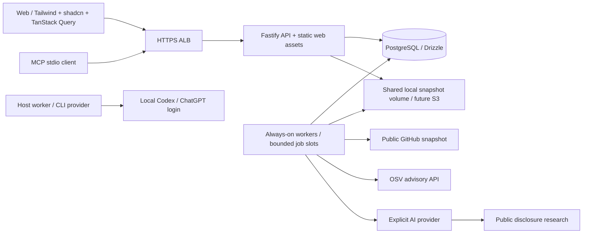

# Deployment contract

Trace targets **two always-on ECS services**: API/web and worker, backed by PostgreSQL. Fargate can host those persistent services, with each worker processing several jobs. **Deployment still requires shared source storage.** The local adapter needs a filesystem accessible to the API, worker and migration processes. S3 is the intended replacement and is documented only. AWS deployment remains unverified.



## Local container setup

The Compose stack uses its own PostgreSQL volume and no host Docker socket. Set a local token of at least 32 characters in `TRACE_TOKEN`, then:

```sh
docker compose up --build -d
```

It runs migrations once, then separate API and worker containers. Open http://localhost:4310, enter your token and run the demo. The stack defaults to `TRACE_AI_PROVIDER=disabled`: it does not spend API money. The live Codex adapter runs on the host using `npm run start:local`; it is not bundled into this production image.

`docker compose down` preserves database history. Do not add `-v` unless intentionally discarding that volume. Local Compose's database password is a documented development credential; use managed secrets in AWS.

## AWS resources and configuration

Provision these within your own account before applying task definitions:

- ECR repository and an image built for Linux x86-64. Use an immutable image digest in production.
- RDS PostgreSQL (Multi-AZ and backups for an availability target). Private security group allows port 5432 only from API/worker tasks.
- An ECS cluster, task subnets, and outbound HTTPS connectivity to GitHub, OSV and the explicitly configured AI provider. No inbound worker port is needed.
- HTTPS ALB forwarding to API port 4310, with `TRACE_PUBLIC_ORIGIN` set to the public HTTPS origin. Serve the web from the API origin, so API authorization is preserved.
- CloudWatch log group `/ecs/trace`.
- Secrets Manager entries containing the full `DATABASE_URL` and shared `TRACE_TOKEN`. A paid deployment additionally needs an OpenAI key; disabled demo deployment does not.
- An ECS execution role permitted to pull the image, write logs and read only those secrets (and decrypt their KMS key if applicable). The application needs no general AWS task-role permissions.

Render three task definitions locally by supplying `AWS_REGION`, `TRACE_IMAGE`, `TRACE_EXECUTION_ROLE_ARN`, `TRACE_DATABASE_SECRET_ARN`, `TRACE_TOKEN_SECRET_ARN`, and `TRACE_PUBLIC_ORIGIN`:

```sh
node scripts/render-ecs.mjs
```

Default output: `output/ecs/{api,worker,migrate}.task.json`. This command only writes JSON. `TRACE_AI_PROVIDER=openai` explicitly enables paid API mode and additionally requires `TRACE_OPENAI_SECRET_ARN`. A personal ChatGPT credential cache must not be shipped as an ECS secret or image layer.

The OpenAI secret is injected only into the worker as `CHATGPT_API_KEY_OX_CHALLENGE`. The API adapter requires this exact variable and does not use other API credentials. Migration `0001` adds shared request accounting: the default 12-request allowance is cumulative across worker replicas/restarts. Calls reserve a slot before sending, including errors and crash recovery; explicit READ COMMITTED transactions prevent stale snapshots from bypassing the cap. Set a deliberately reviewed allowance in worker configuration if more requests are needed. `npm run ai:usage` reports the ledger; the provider dashboard remains authoritative for dollars.

The generated task definitions use Fargate/awsvpc, 0.5 vCPU/1 GB, a non-root user, dropped Linux capabilities, an init process, CloudWatch logs and a 120-second shutdown grace period. Deployment also requires account resources, a listener, target group, ECS services and shared-storage mounts or a replacement object adapter. Configure `TRACE_SNAPSHOT_DIR` explicitly in each role when using the local adapter.

Run the migration task once with the database/network configuration and wait for exit code zero. Then create fixed-desired-count API and worker services using their definitions. One replica each is enough for a demonstration; two each across availability zones also requires replacing the local snapshot backend or provisioning shared storage with appropriate availability. No autoscaling policy or per-job task launch is required. Register API targets by IP; health-check `/health/live` so existing results remain available during worker outages. `/health/ready` additionally checks database and recent worker activity. Worker container health checks its own successfully published database heartbeat.

## Operational boundaries

- Database migrations are explicit, not run by every API replica. An advisory lock serializes concurrent migration invocations.
- All environments use PostgreSQL. Production requires `DATABASE_URL` and an explicit `TRACE_SNAPSHOT_DIR` on storage shared by API/worker/migration processes. Local Compose supplies this shared volume.
- PostgreSQL TLS uses certificate verification. Generated definitions set `DATABASE_SSL=true`. If the deployed RDS CA is not in the runtime trust store, copy the trusted AWS RDS CA bundle into the image (for example `/app/certs/rds.pem`) and set `DATABASE_CA_FILE` to that container path when rendering. The renderer forwards it to API, worker and migration tasks. Never disable verification to work around trust errors.
- Database statements time out on the server after ten seconds, lock waits after five seconds and idle transactions after fifteen seconds. Transaction failures roll back before returning the connection; a terminated session is removed from the pool.
- Legacy SQLite history can be preserved with `npm run db:import-legacy`. Original files remain untouched and require separate backup disposal. Database migrations externalize older PostgreSQL snapshots to the configured object directory.
- Workers claim distinct queue rows with SKIP LOCKED. Each stage commits independently; expired leases recover with fencing and bounded attempts. Database outages prevent new claims; already saved results survive database recovery.
- Default parallelism is two asynchronous jobs per worker, configurable from 1 to 8. Provider calls and acquisition are I/O-bound. Local CLI inference runs in a child process with restricted capabilities.
- API/worker containers do not run Semgrep, require a Docker daemon, execute repository code or install scanned dependencies.
- Authorization uses a shared operator token. Shared mutation quotas protect service admission; tenant isolation requires additional authorization and data boundaries.
- A database backup policy, alerting, quota management and retention operations are necessary for a production availability commitment. AWS connectivity, IAM, TLS and actual failover remain unverified until deployment.

## Source-object lifecycle and isolation

Full acquired files are immutable JSON objects under generated content hashes and publication IDs. Repository paths remain data inside the object. Reads are bounded and hash-checked. Each replacement after expiry has a new physical filename, protecting it from delayed cleanup of an older publication.

The worker runs cleanup at startup and every minute. The default 24-hour retention is renewed on snapshot persistence/reuse and job completion, including final failure. Queued/running references protect an object. Deleting a finished review removes its evidence immediately and schedules deletion of an unreferenced object; filesystem failures are retried. Abandoned temporary writes expire after 24 hours. Exports, backups and standalone benchmark caches require their own retention policy.

Expired snapshots can be fetched at their saved commit with file-hash verification. Unexpectedly missing or damaged objects fail with an explicit storage error. This policy also applies to a new review of the same content until the storage alert is resolved or the object expires. It avoids silently restoring files that security software may have quarantined.

Keep the directory outside the web root, project and synced folders. Restrict it and its ancestors to the service account; other users must not be able to rename or replace them. Existing symlinks and junctions are rejected. Filesystem checks assume the service account and host remain trusted. POSIX publication syncs file and directory metadata. Node cannot sync Windows directories, so power loss can lose local cache entries while the persisted review remains in PostgreSQL.

The review pipeline reads target code as data, renders source as escaped text and gives AI analysis no shell or target-code execution tools. Keep runtimes patched, antivirus enabled and workers isolated from unrelated credentials. These controls reduce exposure; parser/runtime vulnerabilities still require normal patching and process isolation.

A future S3 adapter should use private buckets, blocked public access, scoped task-role permissions, encryption, auditing and lifecycle expiry as a cleanup backstop. Application reference tracking must continue to protect active jobs. No bucket or S3 adapter is included.
