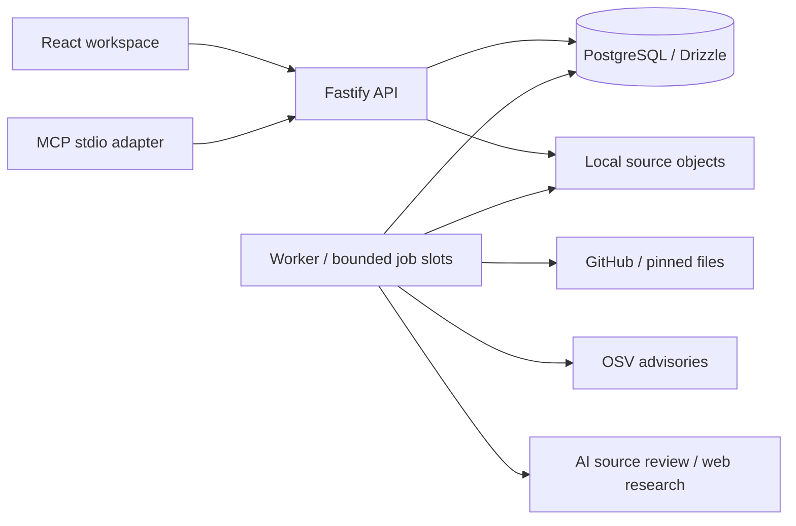

# Product and technical decisions

Trace turns a repository review into a set of actions backed by source evidence. Related findings are grouped into work someone can act on: for example, 81 advisory matches can become one task to update 25 dependencies, with every finding available underneath.

## Web workspace and MCP

The web workspace supports progress tracking, prioritization and evidence inspection. The MCP adapter exposes the same saved reviews and grouped actions to coding agents. Both use the same HTTP API and persistence layer.

A CLI, editor extension and GitHub check were also considered. Web plus MCP provides a standalone evaluation experience and agent integration without requiring a repository installation. Public [OX VibeSec](https://docs.ox.security/vibesec/vibesec) and [OX MCP](https://docs.ox.security/api-documentation/api-reference/model-context-protocol) documentation informed this choice. Those sources describe product capabilities; the assignment leaves the interface choice open.

## Review pipeline

1. Accept a public GitHub URL and pin its commit.
2. Acquire a bounded set of source, template and dependency files.
3. Match exact dependency versions against OSV advisories.
4. Investigate source with two bounded AI passes and validate quoted evidence.
5. Research public disclosures for identified components.
6. Group the retained findings into remediation work, with evidence and verification steps.

OSV supplies advisory data. Custom code handles acquisition, inventory extraction, orchestration, evidence validation and the result experience. An optional Semgrep adapter supports development comparisons; the application pipeline uses the source investigator and bounded static helpers.

## Architecture

PostgreSQL stores queue state, findings, evidence and source manifests. JSONB keeps the complete review document together while indexed columns support claiming, idempotency and expiry. Source objects have a separate retention lifecycle so full repository excerpts can expire while findings remain available.

The API and worker run as separate processes. Jobs use leases, fencing and independent stage commits to preserve completed work after interruptions. Each worker uses a bounded number of asynchronous slots because acquisition and provider calls are primarily I/O-bound. Heartbeats continue while source objects are written.

The frontend uses Tailwind, shadcn components and TanStack Query. Polling reads saved state; it does not trigger inference. The same persisted record supports web display, MCP queries and evidence export.

## Evidence and uncertainty

Source findings require an exact primary citation. Each optional path step has its own citation check; a rejected path leaves the supported primary finding available with a coverage warning. Semantic correctness and exploit prerequisites still require review.

Dependency matches retain the exact package version, advisory and inventory location. Runtime declarations provide a version lead; Next action asks for deployment verification. Research keeps report credibility, applicability and patch status separate. API research references must appear in provider-returned search sources; local CLI references are model-reported. Neither validation proves every claim in a linked page.

The demo uses labeled authored findings and cached advisory data. Live provider failures produce explicit stage outcomes. Successful stages remain available when another stage fails or reaches its budget.

## Scope and tradeoffs

- Public repositories and a shared operator token keep evaluation setup small. Private-repository authorization and tenant isolation are future work.
- Bounded inputs and explicit request accounting control cost. Large inventories use manual dependency continuations; source and research remain scoped to their supplied inputs.
- Local source storage provides expiry, integrity checks and deletion. S3 is the intended production adapter and is documented only. Separate ECS tasks require shared storage before deployment.
- Static helpers cover a CommonJS route subset and direct EJS flows. Cross-file dataflow and broader framework semantics remain detection gaps.
- Reviews and reassessments are initiated explicitly. Continuous monitoring and automated remediation are outside the implemented flow.

## Assignment coverage

| Requirement | Implementation | Verification |
| --- | --- | --- |
| Node.js + TypeScript backend | Fastify API and worker | Type checks, build and API tests |
| Submit a GitHub repository and start a scan | Web form and MCP `start_scan` | Input, admission and idempotency tests |
| Follow scan progress | Persisted stages, activity and running indicators | Browser walkthrough and MCP integration |
| Review meaningful findings | Source, dependency and disclosure findings with evidence | Controlled tests and live Goof evaluation |
| Understand risks and next actions | Grouped remediation plan and expandable finding details | Action-group tests and web/MCP parity |
| Explain decisions and coding-agent use | This document and the README | Included in the submission |

See [verification](verification.md), [benchmark results](benchmark-improvements.md) and [deployment](deployment.md) for measured behavior and operational requirements.
